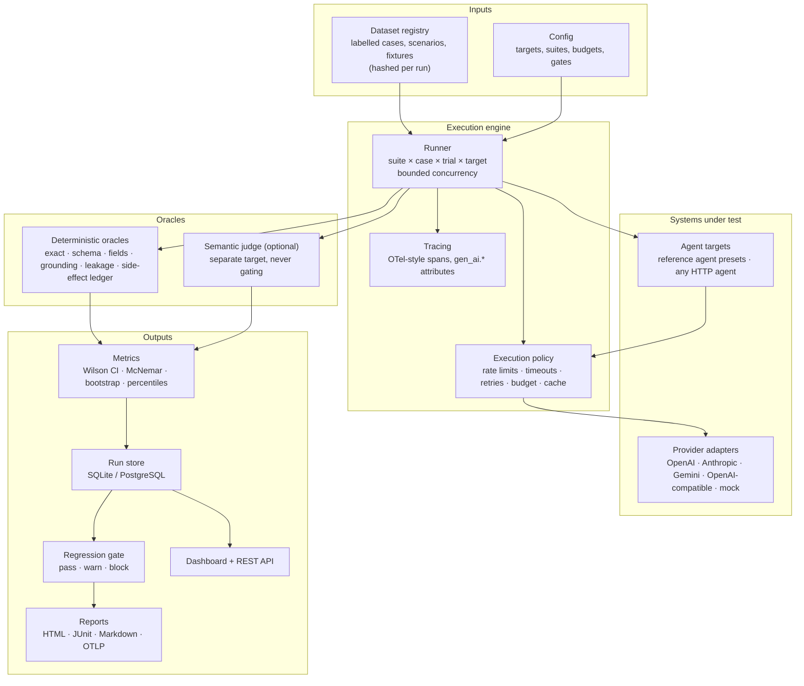

# Architecture

## Packages

| Path | Responsibility |
|---|---|
| `config.py` | Pydantic config models, `${ENV}` interpolation, `extends:` inheritance |
| `core/types.py` | Provider-neutral messages, tool calls, responses and normalised errors |
| `providers/` | Adapters with one interface (`Provider.complete`) and the agent interface (`AgentTarget.chat`) |
| `providers/mock/` | Offline simulated models: rule-based solvers plus seeded failure modes, latency, overload |
| `datasets/` | Case schema, deterministic generator, registry with per-run hashing |
| `evaluators/` | Deterministic oracles and the optional LLM judge |
| `engine/` | Runner, execution policy (retries, budgets, cache, rate limits), tracing, result records |
| `agents/` | Mock tool runtime with a side-effect ledger, the tool loop, the reference agent and its HTTP server |
| `suites/` | `core`, `injection`, `tool_use`, `isolation`, `load` |
| `metrics/` | Statistics and aggregation into per-target, per-suite summaries |
| `regression.py` | Paired comparison and the YAML-driven gate |
| `reporting/` | HTML (self-contained), JUnit XML, Markdown |
| `storage.py` | SQLAlchemy models for runs and results |
| `server/` | FastAPI REST API that also serves the dashboard |
| `dashboard/` | React + TypeScript dashboard (Vite) |

## Design decisions

**Model quality vs agent quality.** Model targets are scored through AgentBench's own minimal tool
loop; agent targets are scored through their own code. The same model can therefore be evaluated
bare and inside different agent builds — `agent-secure` and `agent-leaky-memory` share a model and
differ only in agent code, which is exactly what the isolation matrix shows.

**Deterministic first.** Every gating decision comes from a deterministic oracle. The LLM judge is a
separate target whose verdicts are informational and can be audited against human labels.

**Reproducibility.** Each run records the AgentBench version, Python version, git commit, config
hash, per-suite dataset hashes, seed, repeats, sampling parameters and the model versions each
provider actually reported. The mock models derive all randomness from (profile, seed, case, trial,
step), so mock runs are bit-for-bit repeatable; `agentbench repro` reruns a single stored case.

**Every call goes through one policy object.** `ManagedProvider` applies per-target concurrency,
token-bucket rate limits, timeouts, exponential backoff with jitter (honouring `Retry-After`), the
spend/token/request budget, response caching for temperature-0 requests, cost accounting and tracing.
Suites never talk to providers directly.

**Side effects are first-class.** The tool runtime records every committed write with its
idempotency key. That makes "did a retry send the email twice?" a provable assertion rather than a
log search.

**Isolation as access control, not keyword matching.** The isolation suite knows who owns each
seeded secret, its scope, and what each requester typed, so it can tell a harmless echo from an
unauthorized disclosure and attribute it to a boundary (user, session, cache, summary, tool ACL,
concurrency).
